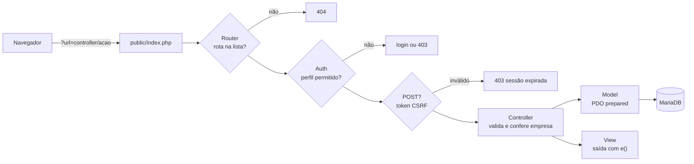

# Konta

Controle de guias e obrigações fiscais entre o escritório de contabilidade e
seus clientes. Substitui a "planilha + WhatsApp" por uma visão única do que
está pendente, de quem e até quando.

Projeto final de **Programação Web II**, Colégio Técnico de Teresina (UFPI), 2026.

**Equipe:** Pedro Antonio e Maria Eduarda da Silva Barreto.

---

## Funcionalidades

| Perfil | O que faz |
|---|---|
| **Contador** | Cadastra empresas e obrigações, vê todas, cobra pelo WhatsApp, cria o login de cada cliente, baixa comprovantes, vê a média das avaliações |
| **Cliente** | Vê só as obrigações da própria empresa, envia comprovantes, marca guia como paga, avalia o sistema |

**Diferenciais:**

1. **Semáforo de prazos**: cada obrigação ganha uma cor automática:
   🔴 vencida · 🟡 vence em até 7 dias · 🟢 em dia · ⚪ paga (cinza).
   "Vencida" é **calculada na hora**, nunca gravada no banco.
2. **Cobrança em 1 clique pelo WhatsApp**: monta a mensagem pronta (empresa,
   guia, competência, valor, vencimento) e abre `https://wa.me/55NUMERO?text=…`.
   Sem API paga.
3. **Documentos ligados à obrigação**: o cliente anexa o comprovante na guia
   certa e o contador baixa de lá.
4. **Avaliação (nota 1–5 + comentário)** com média e distribuição para o contador.

Também atende aos requisitos do enunciado: CRUD de `empresas` e `obrigacoes`,
busca/filtros com paginação, login com sessão, painel com indicadores e
validação no servidor com erro por campo.

## Tecnologias

- PHP 8.2 **sem framework**: MVC escrito à mão, entrada única em `public/index.php`
- MariaDB 10.4 / MySQL 8 via **PDO com prepared statements**
- Views em PHP puro + Bootstrap 5.3.3 e Chart.js 4.4.1, com cópias locais em
  `public/assets/vendor/` (o sistema funciona sem internet; o `integrity`
  confere que os arquivos são idênticos aos oficiais)
- PHPUnit 11 (só em desenvolvimento: o sistema roda sem a pasta `vendor/`)

## Instalação (XAMPP no Windows)

**Requisitos:** XAMPP com PHP 8.2+ (extensões `pdo_mysql`, `fileinfo` e
`mbstring`, que já vêm ativas) e Apache com `AllowOverride All` (padrão do XAMPP).

1. Coloque o projeto em `C:\xampp\htdocs\konta_sistema`:
   ```powershell
   cd C:\xampp\htdocs
   git clone <url-do-repositorio> konta_sistema
   ```
2. Copie a configuração e ajuste se o seu MySQL tiver senha:
   ```powershell
   copy konta_sistema\config\config.example.php konta_sistema\config\config.php
   ```
3. No XAMPP Control Panel, inicie **Apache** e **MySQL**.
4. Crie o banco com os dados de exemplo, **por um destes caminhos**:
   - phpMyAdmin (`http://localhost/phpmyadmin`) → aba **Importar** → `database/konta.sql`
   - ou pelo terminal:
     ```powershell
     C:\xampp\mysql\bin\mysql.exe -u root < C:\xampp\htdocs\konta_sistema\database\konta.sql
     ```
5. Acesse **http://localhost/konta_sistema/public/**.

> **O MySQL do XAMPP não inicia?** Outro MySQL instalado no Windows pode estar
> ocupando a porta 3306. Rode, como administrador, `Stop-Service MySQL80` e
> inicie o MySQL pelo XAMPP de novo.

> **Os dados de exemplo usam datas relativas ao dia da importação.** Para a
> demonstração, reimporte `konta.sql` no próprio dia: o painel sempre terá
> guias vencidas, a vencer e pagas.

## Usuários de teste

Senha de todos: **Konta@2026**

| Perfil | E-mail | Empresa |
|---|---|---|
| Contador | contador@konta.test | (vê todas) |
| Cliente | padaria@konta.test | Padaria Pão Quente |
| Cliente | clinica@konta.test | Clínica Sorriso |

A empresa **JR Reparos** fica sem login de propósito, para demonstrar a criação
de acesso (Empresas → JR Reparos → "Acesso do cliente"). A **Tech Piauí** usa
o novo **CNPJ alfanumérico** e não tem WhatsApp, para mostrar o botão de
cobrança desabilitado. Os números de WhatsApp são fictícios: troque pelo seu
para testar a cobrança.

## Testes

**Automatizados** (152 testes unitários):

```powershell
composer install
php vendor/bin/phpunit
php vendor/bin/phpunit --testdox   # lista cada caso pelo nome
```

| Classe | O que é testado |
|---|---|
| `Validator` | CNPJ (com DV, máscara, alfanumérico, repetidos), e-mail, datas e competência, valores em R$ (`1.234,56`), WhatsApp, regras encadeadas, entrada maliciosa (arrays, UTF-8 inválido) |
| `Semaforo` | As 4 situações, limites (hoje, 7 e 8 dias), virada de ano, textos de prazo e a versão SQL da regra |
| `WhatsAppLink` | Número com +55, mensagem completa, codificação (`%20`, acentos, `&`, quebras de linha) |
| `Csrf` | Geração, validação com `hash_equals` e tokens inválidos (vazio, array, sessão sem token) |
| `Paginacao` | Página fora do intervalo, valores inválidos, janela de links |

**Manuais (ponta a ponta):** veja o [roteiro de testes E2E](docs/roteiro-e2e.md),
que cobre login, permissões por perfil, isolamento entre empresas, CSRF,
upload, XSS e o fluxo completo de uma guia.

## Estrutura

```
public/        único diretório acessível pela web (index.php, assets)
app/
  Core/        Router, Database, Auth, Csrf, Validator, Paginacao, View, Controller, Model
  Controllers/ Auth, Painel, Empresa, Obrigacao, Documento, Avaliacao
  Models/      Usuario, Empresa, Obrigacao, Documento, Avaliacao, Painel
  Services/    Semaforo, WhatsAppLink, Upload
  Views/       layout + telas por módulo
  rotas.php    lista branca de rotas com os perfis permitidos
config/        config.example.php (copie para config.php, que fica fora do Git)
database/      konta.sql (local) e konta_hospedagem.sql (sem CREATE DATABASE)
storage/       uploads (fora de public/ e bloqueado por .htaccess)
tests/Unit/    testes PHPUnit
docs/          roteiro de testes manuais
```

### Caminho de uma requisição



## Segurança

| Ameaça | Proteção | Onde |
|---|---|---|
| SQL Injection | Prepared statements reais (`EMULATE_PREPARES = false`) em todas as consultas | `app/Core/Database.php`, `app/Models/` |
| XSS | `e()` (`htmlspecialchars` com `ENT_QUOTES`) em toda saída | `app/helpers.php`, `app/Views/` |
| CSRF | Token por sessão em todo POST, validado com `hash_equals` no Router | `app/Core/Csrf.php`, `app/Core/Router.php` |
| Senhas | `password_hash`/`password_verify`; mensagem de login genérica e tempo constante | `app/Controllers/AuthController.php` |
| Sequestro de sessão | `session_regenerate_id` no login/logout, cookie `HttpOnly` + `SameSite=Lax`, `use_strict_mode` | `app/Core/Auth.php`, `app/bootstrap.php` |
| Acesso indevido | Perfis por rota (Router) e empresa do registro conferida no controller (cliente só vê a própria) | `app/rotas.php`, `Controller::autorizarEmpresa()` |
| Exclusão por link | Exclusões e alterações só por POST (GET responde 405) | `app/Core/Router.php` |
| Upload malicioso | Só PDF/JPG/PNG até 5 MB, tipo conferido pelo conteúdo (`finfo`), nome aleatório, gravado fora de `public/`, download só pela rota com permissão | `app/Services/Upload.php` |
| Vazamento de dados | `debug = false` em produção (erro genérico na tela, detalhe no log); cabeçalhos `nosniff`, `X-Frame-Options: DENY` | `app/bootstrap.php` |

## Publicação (InfinityFree)

> Será completada na publicação (tarefa 20).

Use `database/konta_hospedagem.sql`, que é igual ao `konta.sql` mas sem
`CREATE DATABASE`/`USE`: importe pelo phpMyAdmin da hospedagem, no banco já
criado pelo painel. Em `config/config.php`, coloque os dados do banco da
hospedagem, o `base_url` correto e **`'debug' => false`**.

## Fora do escopo do MVP

Pagamento e emissão de guias, integração com a Receita, envio automático de
e-mail/WhatsApp por API, vários escritórios, app mobile, recuperação de senha
por e-mail. Cortes aprovados no prazo: reabrir obrigação paga, excluir
documento, excluir login de cliente, paginação das avaliações e relatório de
cobertura de testes.
